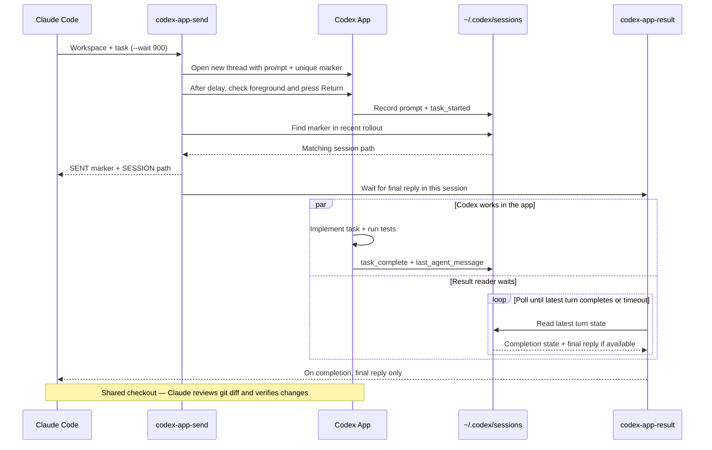

# claude-codex-bridge

[English](README.md) | [简体中文](README.zh-CN.md)

Let Claude Code delegate implementation to the **Codex desktop app**, then
review the changes. Scripts can use the same two commands.

The conversation starts directly in the app, avoiding the session-sync delay
that can occur with `codex exec`. Claude reads only the final reply instead of
the full rollout, keeping transcript token use low, and reviews the actual diff.


*Illustration — conversations start directly in the app; only the final reply
returns to Claude for review alongside the diff.*

## How it works



1. `codex-app-send` adds a unique marker to the prompt and opens
   `codex://threads/new?path=...&prompt=...` to create a conversation with a
   prefilled prompt.
2. After a short delay, AppleScript activates Codex and presses Return only
   after checking that Codex is the foreground app.
3. The script finds the marker in a recently modified rollout under
   `~/.codex/sessions` to confirm submission and reports the session file path.
4. With `--wait`, it calls `codex-app-result`, which reads the final
   `last_agent_message` from `task_complete`. If a newer `task_started` exists,
   it waits for that turn instead of returning an old reply.

## Terminal demo


*Illustration — sample summary, not a recorded run. The session path is
abbreviated; actual output uses an absolute path. The 12 passing tests belong
to the example task, not this repository's test suite.*

## Requirements

- macOS for sending; the result reader also works on Linux.
- The Codex desktop app, installed and ready to accept tasks.
- Bash, `python3`, and standard system command-line utilities.
- Claude Code if you want to use the bundled skill.

Before the first send, allow the application running the script (your terminal
or Claude App) in **System Settings > Privacy & Security > Accessibility**.
If macOS shows an Automation permission prompt for controlling System Events,
allow it as well.

## Installation

```bash
git clone https://github.com/Shuo-O/claude-codex-bridge.git
cd claude-codex-bridge
./install.sh
```

The installer links both commands into `$HOME/.local/bin` and copies the skill
into `$HOME/.claude/skills/codex-app`. It prints a reminder if the command
directory is not on `PATH`. For the default directory, add this to your shell
configuration if needed:

```bash
export PATH="$HOME/.local/bin:$PATH"
```

Keep the checkout in place: the commands are symlinks into it. Re-running the
installer updates the links and skill copy. It refuses to overwrite a regular
file at a command destination.

```bash
# Custom destinations (PREFIX is the command directory, not its parent).
PREFIX="$HOME/bin" CLAUDE_SKILLS_DIR="$HOME/.claude/skills" ./install.sh

./install.sh --no-skill             # Install commands only
./install.sh --uninstall            # Remove command links and copied skill
./install.sh --uninstall --no-skill  # Remove command links, preserve skill
./install.sh --help
```

Use the same destination variables when uninstalling a custom installation.
Uninstall removes command links pointing to this checkout and the whole
installed `codex-app` skill directory; keep any skill edits elsewhere first.

## Usage

Options must precede the workspace, which must be an existing absolute path.

```bash
# Send and get the session file path.
codex-app-send "$HOME/projects/example" 'Implement the requested fix and run tests.'

# Wait up to 15 minutes for the final reply.
codex-app-send --wait 900 "$HOME/projects/example" 'Fix the failing test; do not commit.'

# Read a longer task from a file, or from standard input.
codex-app-send --wait 900 "$HOME/projects/example" @/tmp/task.md
printf '%s\n' 'Review the current diff.' | codex-app-send "$HOME/projects/example" -

# Prefill only; you press Return in the app yourself.
codex-app-send -n "$HOME/projects/example" 'Explain the project structure.'

# Quiet mode prints only the rollout path after sending.
session=$(codex-app-send -q "$HOME/projects/example" 'Run the tests and summarize.')
codex-app-result --wait 600 "$session"

# Read an already-known rollout without waiting.
codex-app-result /path/to/rollout.jsonl
```

Normal send output is `SENT <tag>` and `SESSION <rollout path>`. With `--wait`,
it adds `----- FINAL -----` followed by the final reply. `-q --wait` omits
labels but still prints the session path **before** the final reply; use
`codex-app-result` when you need final-reply-only output. `-n` skips submission
confirmation and waiting, even with `--wait`; `-n -q` prints nothing.

Use `-d SECONDS` / `--delay SECONDS` to adjust the delay before Return (default
2.5 seconds). `--help` lists options; `codex-app-send --version` shows the version.
Use nonnegative integer seconds for wait/confirmation timeouts and positive
seconds for polling. A wait timeout does not cancel the task in the app.

## Environment variables

| Variable | Default | Purpose |
| --- | --- | --- |
| `PREFIX` | `$HOME/.local/bin` | Installer command directory |
| `CLAUDE_SKILLS_DIR` | `$HOME/.claude/skills` | Installer skill parent directory |
| `CODEX_APP_BUNDLE_ID` | `com.openai.codex` | App activated and checked by AppleScript |
| `CODEX_HOME` | `$HOME/.codex` | Base directory for session lookup |
| `CODEX_SESSIONS_DIR` | `$CODEX_HOME/sessions` | Explicit session directory; overrides `CODEX_HOME` |
| `CODEX_SEND_DELAY` | `2.5` | Delay before Return; `--delay` overrides it |
| `CODEX_SEND_CONFIRM_TIMEOUT` | `30` | Submission confirmation timeout in seconds |
| `CODEX_RESULT_POLL_INTERVAL` | `5` | Seconds between result checks |

## Exit codes

| Code | `codex-app-send` | `codex-app-result` |
| --- | --- | --- |
| `0` | Submitted, or prefilled with `-n`; with `--wait`, reply returned | Final reply returned |
| `1` | Error or submission not confirmed | Error, including a missing file |
| `2` | Final-reply wait timed out; task continues | Latest turn incomplete, or wait timed out |

Polling can exceed the requested wait by up to a polling interval plus file
read time. A final reply confirms turn completion, not that tests or the task
itself succeeded. Review the reply and changes.

## Use the skill in Claude Code

After installation, ask Claude Code, for example:

> Use the codex-app skill to delegate implementation of the failing test fix
> in this project to Codex. Do not commit or push. When it finishes, review
> the diff and run the tests yourself.

The skill asks Claude to check the working tree, write a self-contained task,
send it to Codex, read only the final reply, and review the resulting diff.
Both agents share the checkout: avoid simultaneous edits while Codex is working.

## Caveats

- The parameters of `codex://threads/new` come from the app's internal
  implementation, **not a public API**. App updates may break this bridge.
- Sending briefly takes foreground focus. Return is pressed only after Codex
  is confirmed to be in the foreground. Accessibility access is required.
- The app's local rollout format is also an implementation detail. The reader
  recognizes `task_started` and `task_complete`; interrupted turns without a
  completion event may keep returning code `2`.
- Submission confirmation failure does not prove nothing was sent. Check the
  app before retrying to avoid duplicate work.

## Tests

```bash
bash tests/test.sh
```

The tests use Bash, standard system utilities, and the commands' existing
`python3` dependency, with no test framework. They use temporary fixtures and
installation directories, test only non-sending argument paths, and block
`open` and `osascript`. CI runs on macOS and Ubuntu; it does not send real tasks.

## License and disclaimer

[MIT](LICENSE). This is an independent project, not an official OpenAI or
Anthropic project, and is not affiliated with or endorsed by either company.
