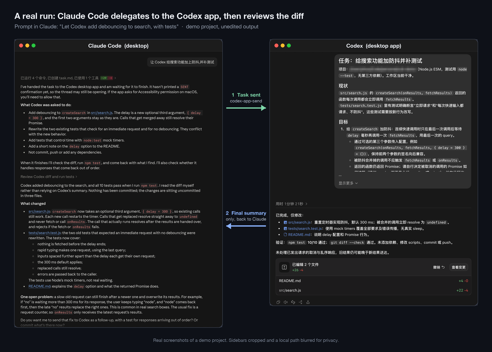
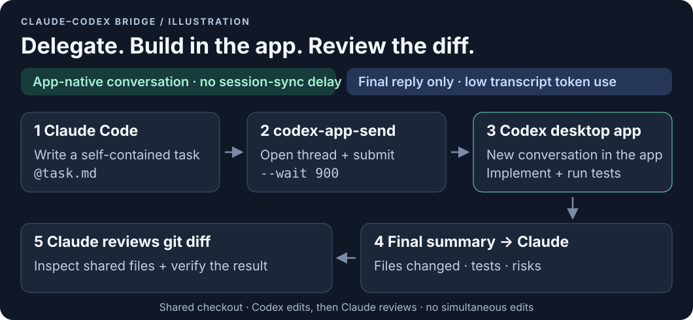
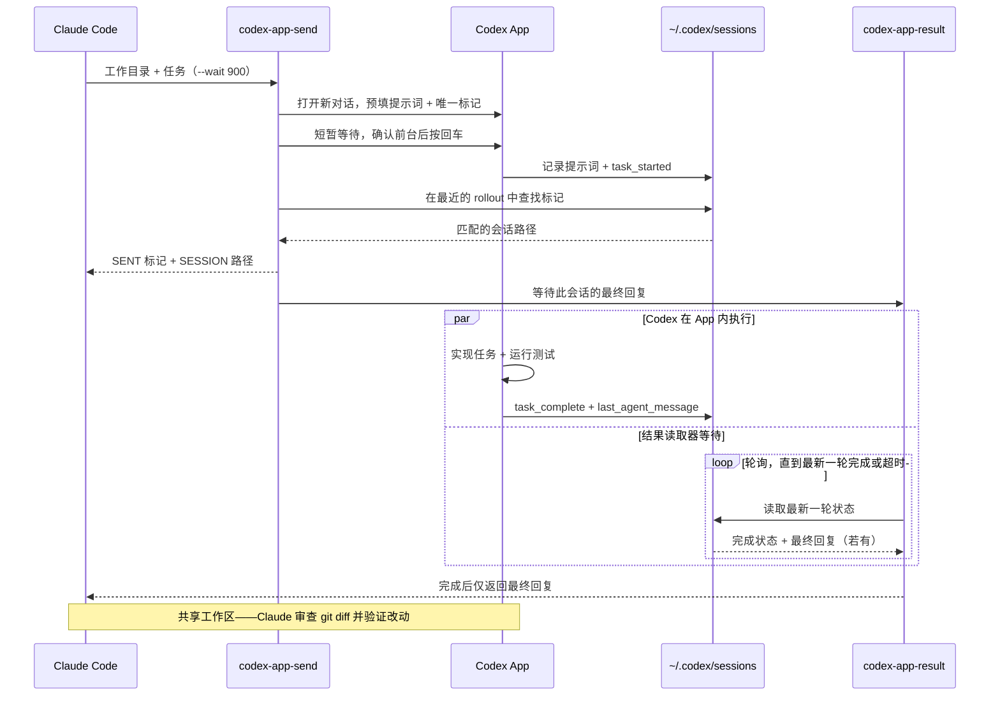
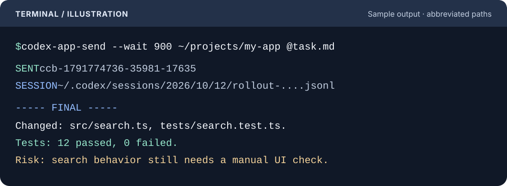

# claude-codex-bridge

[English](README.md) | [简体中文](README.zh-CN.md)

让 Claude Code 把实现交给 **Codex 桌面 App**，再由 Claude 审查改动。
普通脚本也可以使用这两个命令。

对话直接在 App 中创建，避免 `codex exec` 可能出现的会话同步延迟。
Claude 只读取最终回复，不读取完整 rollout，从而减少对话记录带来的 token 消耗，
并通过实际 diff 审查改动。



*在演示项目中的真实运行。侧边栏已裁剪，一处本地路径已模糊处理。*



*示意图（illustration）——会话直接出现在 App 中，无需等待会话同步；
只将最终回复回传给 Claude，降低 token 消耗，再结合 diff 审查。*

## 工作原理



1. `codex-app-send` 为提示词追加唯一标记，通过
   `codex://threads/new?path=...&prompt=...` 创建对话并预填提示词。
2. 短暂等待后，AppleScript 激活 Codex，确认它是前台应用后才按回车。
3. 脚本在 `~/.codex/sessions` 下最近修改的 rollout 中查找标记，
   确认提交并返回会话文件路径。
4. 指定 `--wait` 时调用 `codex-app-result`，读取 `task_complete` 中的
   `last_agent_message`。如果此后又有 `task_started`，则等待新一轮完成，
   不会返回上一轮的旧回复。

## 要求

- 发送需要 macOS；结果读取器也可在 Linux 上运行。
- 已安装 Codex 桌面 App，并准备好接收任务。
- Bash、`python3` 和系统标准命令行工具。
- 使用附带 skill 时需要 Claude Code。

首次发送前，在 **系统设置 > 隐私与安全性 > 辅助功能** 中，授权运行脚本的应用
（终端或 Claude App）。如果 macOS 弹出控制 System Events 的“自动化”权限提示，
也需要允许。

## 安装

### 让 AI 自动安装

将下面的 prompt 粘贴给 Claude Code 或 Codex：

```text
请帮我安装 https://github.com/Shuo-O/claude-codex-bridge：
1. 检查当前系统是否为 macOS，以及是否已安装 Codex 桌面 App 和 python3；如不满足，请停止并告诉我。
2. 将仓库克隆到 ~/.local/share/claude-codex-bridge（如果已存在则执行 git pull），然后在该目录运行 ./install.sh。
3. 确认 ~/.local/bin 在我的 PATH 中；如果不在，请告诉我应添加到 shell 配置中的确切内容，不要自行编辑配置。
4. 执行 codex-app-send --version 和 codex-app-result --help 验证，并确认 ~/.claude/skills/codex-app/SKILL.md 存在。
5. 不要更改任何系统设置。请提醒我：首次实际发送前，必须在“系统设置 > 隐私与安全性 > 辅助功能”中授权运行你的应用（终端或 Claude）。
6. 可选：在我确认后，运行一个无害测试：codex-app-send -w 120 "$PWD" "Reply with OK only. Do not read or modify files."
报告你执行的操作和验证输出。
```

### 手动安装

```bash
git clone https://github.com/Shuo-O/claude-codex-bridge.git
cd claude-codex-bridge
./install.sh
```

安装脚本将两个命令软链接到 `$HOME/.local/bin`，并将 skill 复制到
`$HOME/.claude/skills/codex-app`。如果命令目录不在 `PATH` 中，脚本会提示。
默认目录可按需在 shell 配置中加入：

```bash
export PATH="$HOME/.local/bin:$PATH"
```

请保留仓库目录，命令软链接指向其中的文件。重复安装会更新链接及 skill 副本。
如果命令目标位置已有普通文件，安装脚本会拒绝覆盖。

```bash
# 自定义目录（PREFIX 是命令目录本身，不是其上级目录）。
PREFIX="$HOME/bin" CLAUDE_SKILLS_DIR="$HOME/.claude/skills" ./install.sh

./install.sh --no-skill             # 仅安装命令
./install.sh --uninstall            # 删除命令链接和 skill 副本
./install.sh --uninstall --no-skill  # 删除命令链接，保留 skill
./install.sh --help
```

卸载自定义安装时，请使用相同的目录变量。卸载会删除指向当前仓库的命令链接，
以及整个已安装的 `codex-app` skill 目录；如有自行修改，请先另存。

## 用法

### 终端效果



*示意图（illustration）——总结为示例，并非真实运行记录。会话路径已缩写，
实际输出为绝对路径。12 项测试通过是示例任务的结果，不是本仓库的测试数量。*

选项放在工作目录之前；工作目录必须是已存在的绝对路径。

```bash
# 发送任务，获取会话文件路径。
codex-app-send "$HOME/projects/example" '实现要求的修复并运行测试。'

# 最多等待 15 分钟，读取最终回复。
codex-app-send --wait 900 "$HOME/projects/example" '修复失败的测试，不要提交。'

# 从文件或标准输入读取较长任务。
codex-app-send --wait 900 "$HOME/projects/example" @/tmp/task.md
printf '%s\n' '审查当前 diff。' | codex-app-send "$HOME/projects/example" -

# 仅预填，由你在 App 中手动按回车。
codex-app-send -n "$HOME/projects/example" '解释项目结构。'

# 安静模式在发送后只输出 rollout 路径。
session=$(codex-app-send -q "$HOME/projects/example" '运行测试并总结。')
codex-app-result --wait 600 "$session"

# 读取已知 rollout，不等待。
codex-app-result /path/to/rollout.jsonl
```

默认发送输出为 `SENT <tag>` 和 `SESSION <rollout path>`。
指定 `--wait` 时，追加 `----- FINAL -----` 和最终回复。
`-q --wait` 去掉标签，但仍在最终回复**之前输出会话路径**；
需要纯最终回复时使用 `codex-app-result`。
`-n` 跳过提交确认和等待，即使同时指定 `--wait`；`-n -q` 不输出内容。

使用 `-d SECONDS` / `--delay SECONDS` 调整按回车前的延迟（默认 2.5 秒）。
`--help` 列出选项；`codex-app-send --version` 显示版本。
等待及提交确认超时请使用非负整数秒，轮询间隔请使用正数秒。
等待超时不会取消 App 内的任务。

## 环境变量

| 变量 | 默认值 | 用途 |
| --- | --- | --- |
| `PREFIX` | `$HOME/.local/bin` | 安装命令的目录 |
| `CLAUDE_SKILLS_DIR` | `$HOME/.claude/skills` | 安装 skill 的上级目录 |
| `CODEX_APP_BUNDLE_ID` | `com.openai.codex` | AppleScript 激活并检查的 App |
| `CODEX_HOME` | `$HOME/.codex` | 会话查找的基础目录 |
| `CODEX_SESSIONS_DIR` | `$CODEX_HOME/sessions` | 显式指定会话目录，优先于 `CODEX_HOME` |
| `CODEX_SEND_DELAY` | `2.5` | 按回车前的延迟，`--delay` 可覆盖 |
| `CODEX_SEND_CONFIRM_TIMEOUT` | `90` | 提交确认超时，单位秒；App 可能缓冲会话写入 |
| `CODEX_RESULT_POLL_INTERVAL` | `5` | 两次结果检查之间的秒数 |

## 退出码

| 退出码 | `codex-app-send` | `codex-app-result` |
| --- | --- | --- |
| `0` | 已提交，或通过 `-n` 预填；指定 `--wait` 时表示已返回回复 | 已返回最终回复 |
| `1` | 出错或未确认提交 | 出错，包括文件不存在 |
| `2` | 等待最终回复超时，任务继续运行 | 最新一轮未完成，或等待超时 |

轮询可能使实际等待超过指定时间，最多多出一个轮询间隔及文件读取时间。
最终回复只代表该轮已完成，不代表测试或任务本身成功，请审查回复和改动。

## 在 Claude Code 中使用 skill

安装后，可以这样要求 Claude Code：

> 使用 codex-app skill，把当前项目中修复失败测试的实现交给 Codex。
> 不要提交或推送。完成后，你审查 diff 并自行运行测试。

skill 会引导 Claude 检查工作区、编写独立完整的任务、发送给 Codex、
仅读取最终回复，并审查实际 diff。两个代理共享同一工作区，
Codex 工作时应避免同时编辑。

## 注意事项

- `codex://threads/new` 的参数来自 App 内部实现，**并非公开 API**，
  App 更新后可能失效。
- 发送会短暂抢占前台焦点。只有确认 Codex App 位于前台时才会按回车，
  且需要辅助功能权限。
- App 本地 rollout 格式也是实现细节。读取器识别 `task_started` 和
  `task_complete`；如果中断的轮次没有完成事件，可能持续返回退出码 `2`。
- 提交确认失败不代表一定没有发送。重试前请检查 App，避免重复执行任务。

## 测试

```bash
bash tests/test.sh
```

测试使用 Bash、系统标准工具及命令本身已有的 `python3` 依赖，无需测试框架。
测试使用临时 fixture 和安装目录，只覆盖不会发送的参数路径，并拦截
`open` 与 `osascript`。CI 在 macOS 和 Ubuntu 上运行，不发送真实任务。

## 许可证与免责声明

采用 [MIT 许可证](LICENSE)。这是独立项目，并非 OpenAI 或 Anthropic 官方项目，
与两家公司没有隶属关系，也未获得其背书。
